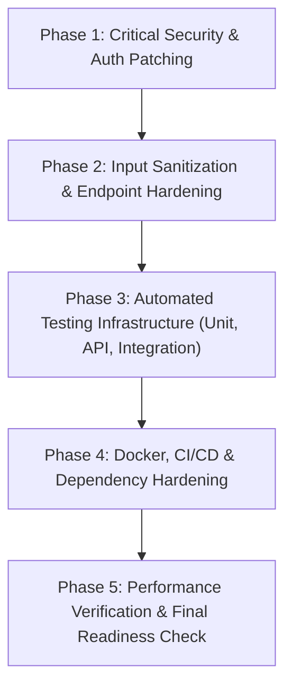

# CinePulse — Complete Project Requirements & Security Quality Audit

> **Document Type:** Project-Specific Security, Quality & Production Readiness Audit  
> **Target System:** CinePulse Movie Recommendation System (Node.js/Express, React/Vite, MongoDB/Mongoose, Python ML)  
> **Audit Status:** Phase Two — Completed Inspection & Requirement Discovery (Read-Only)  
> **Date:** November 23, 2026  
> **Classification:** Confidential / Security Architecture Review  

---

## Executive Summary

A comprehensive architectural, security, performance, code quality, and testing audit was performed across the CinePulse code repository. The CinePulse application features a dual architecture:
1. **Frontend**: React 18, Vite 6, Tailwind CSS 3, React Router DOM 6.
2. **Backend REST API**: Node.js v24 (ES Modules), Express.js 4, Mongoose 8.x, JWT authentication, Bcrypt password hashing, Nodemailer (Gmail SMTP verification), Multer file upload, Winston/Morgan logging.
3. **Machine Learning Pipeline**: Standalone Python 3.12 Scikit-Learn suite + Node.js/Browser in-memory Content-Based KNN engine using TF-IDF and Cosine Distance.

While the application features well-designed core recommender algorithms and modern UI components, **critical security vulnerabilities, severe authentication bypass vectors, exposed secrets, unauthenticated privileged endpoints, and an absence of automated test suites** were identified.

Application code was **not modified** during this audit. This document presents the exhaustive audit results, risk evaluations, and remediation roadmap for stakeholder review and approval.

---

## Part 1: Comprehensive Category Evaluation (20 Audit Categories)

For every category, we evaluate the 7 mandatory dimensions:
- **What is required?**
- **Why is it required?**
- **What risk does it prevent?**
- **Which project component does it affect?**
- **Which tool or technique should be used?**
- **Priority:** Mandatory | Recommended | Optional | Not Applicable
- **How will it be verified?**

---

### 1. Functional Requirements
- **What is required?** Verification of core end-user journeys: catalog exploration, search, genre filtering, TMDB movie syncing, personalized KNN recommendations, user ratings, watchlist tracking, watched history, and avatar uploading.
- **Why is it required?** Ensures that user preferences accurately steer the TF-IDF Cosine distance vector calculations and that catalog state remains synchronized across MongoDB and frontend cache.
- **Component Affected:** `src/pages/*`, `src/context/*`, `server/controllers/*`, `server/models/*`.
- **Risk Prevented:** Broken core business logic, recommendation drift, state desynchronization between client and database.
- **Tool/Technique:** End-to-end integration flows, API contract checks, manual functional testing.
- **Priority:** **Mandatory**
- **Existing Protections:** Reactive React Context (`AuthContext`, `MovieContext`), resilient UI error boundary (`ErrorBoundary.jsx`), fallbacks in `moviesData.js`.
- **Missing Protections:** No automated validation of user preference mathematical weighting or multi-user state isolation.
- **Verification Method:** Execute functional test suites covering user registration, rating submission, recommendation re-ranking, and watchlist toggling.

---

### 2. Security Requirements
- **What is required?** Comprehensive hardening against the OWASP Top 10: credential protection, secret sanitization, ReDoS mitigation, upload sandboxing, CSP, and CORS policy enforcement.
- **Why is it required?** The application currently embeds live production credentials and third-party API keys directly into source code repositories and lacks input sanitization on search queries.
- **Component Affected:** `server/server.js`, `server/utils/emailService.js`, `server/services/tmdbService.js`, `server/controllers/movieController.js`, `docker-compose.yml`.
- **Risk Prevented:** Remote credential harvesting, email relay hijacking, Denial of Service via Regex exponential backtracking, unauthorized API quota exhaustion.
- **Tool/Technique:** Secret removal, `.env` parameterization, input sanitization via regex escaping, Helmet CSP tightening.
- **Priority:** **Mandatory**
- **Existing Protections:** `helmet({ crossOriginResourcePolicy: false })`, `express-rate-limit`, Bcrypt password hashing (`salt=10`).
- **Missing Protections:** Secret scanning in git/CI, regex sanitization, Content Security Policy headers, removal of hardcoded credentials.
- **Verification Method:** Static analysis security testing (SAST), secret scanning with git-secrets/TruffleHog, ReDoS fuzzing.

---

### 3. Authentication and Authorization
- **What is required?** Elimination of backdoor verification codes, strict enforcement of email OTP activation before login, removal of client-side fake auth tokens, and Role-Based Access Control (RBAC) on administrative endpoints.
- **Why is it required?**
  1. A hardcoded OTP bypass (`123456`) in `server/models/User.js` allows any attacker to verify and hijack any registered account.
  2. `server/controllers/authController.js` auto-verifies unverified users on password login without OTP validation.
  3. `src/services/api.js` fabricates synthetic `local-demo-token` when backend is offline.
  4. `POST /api/movies/sync-tmdb` is completely unauthenticated and public.
- **Component Affected:** `server/models/User.js`, `server/controllers/authController.js`, `server/routes/movieRoutes.js`, `src/services/api.js`.
- **Risk Prevented:** Complete authentication bypass, account takeover, unauthorized administrative database manipulation.
- **Tool/Technique:** Remove backdoor check, enforce `user.isVerified` gate, remove client token spoofing, add `protect` and `authorize('admin')` middleware to `/sync-tmdb`.
- **Priority:** **Mandatory**
- **Existing Protections:** JWT issuance via `jsonwebtoken` (30-day expiry), Bcrypt pre-save password hashing, rate limiting on auth routes (`30 req / 15 min`).
- **Missing Protections:** OTP bypass removal, strict verification gating, admin protection on sensitive routes.
- **Verification Method:** Automated auth API tests asserting invalid OTP rejects (including 123456), unverified user login fails, and unauthenticated `/sync-tmdb` returns HTTP 401/403.

---

### 4. API Security
- **What is required?** Input validation (schema checking), parameter sanitization, rate limiting on sensitive routes, removal of sensitive data from health checks, and strict CORS policies.
- **Why is it required?**
  1. `GET /api/health` currently leaks the administrator's email address (`smtpUser: 'adminrecallc@gmail.com'`).
  2. `POST /api/watchlist/rate` does not validate `NaN` ratings.
  3. Search query parameters in `GET /api/movies?search=...` are passed directly into MongoDB `$regex` without escaping.
- **Component Affected:** `server/server.js`, `server/controllers/movieController.js`, `server/controllers/watchlistController.js`.
- **Risk Prevented:** Sensitive information disclosure, ReDoS attacks, unexpected database write errors.
- **Tool/Technique:** Express input validation (Zod/Joi or strict schema guards), regex escaping, sanitizing health check output.
- **Priority:** **Mandatory**
- **Existing Protections:** `globalLimiter` (300 req / 15 min), `authLimiter` (30 req / 15 min), Express JSON payload limit (10MB).
- **Missing Protections:** Request body validation schemas, regex escaping helper, sanitized health check response.
- **Verification Method:** API security tests with invalid payloads, malformed JSON, boundary ratings (`-1`, `6`, `NaN`, `"abc"`), and ReDoS patterns.

---

### 5. Database Security and Integrity
- **What is required?** Authentication for MongoDB daemon, container network isolation, compound index consistency, query validation, and prevention of NoSQL injection.
- **Why is it required?**
  1. `docker-compose.yml` maps port `27017:27017` to the host without password authentication or IP binding.
  2. Unsanitized query operators in query params could lead to NoSQL injection if objects are passed instead of strings.
- **Component Affected:** `docker-compose.yml`, `server/config/db.js`, `server/models/*`.
- **Risk Prevented:** Unauthorized database dumping, data tampering, ransomware attacks on exposed MongoDB instances.
- **Tool/Technique:** Enable MongoDB authentication in Docker Compose (`MONGO_INITDB_ROOT_USERNAME/PASSWORD`), bind to `127.0.0.1`, use Mongoose strict mode and explicit string casting.
- **Priority:** **Mandatory**
- **Existing Protections:** Mongoose schema validations, compound unique indexes (`{ userId: 1, movieId: 1 }` on `Rating` and `Watchlist`), unique index on `Movie.id` and `Movie.tmdbId`.
- **Missing Protections:** Docker MongoDB credentials, Mongo daemon bind-address restriction, NoSQL query sanitization (`express-mongo-sanitize`).
- **Verification Method:** Attempt unauthenticated remote MongoDB connection; run automated NoSQL injection test payloads (`{ "email": { "$gt": "" } }`).

---

### 6. Unit Testing
- **What is required?** Comprehensive unit test suite covering:
  - TF-IDF vectorization and tokenization logic (`tokenizeText`, document soup, L2 normalization).
  - Cosine distance and similarity computations.
  - User profile synthesis from ratings and favorite genres.
  - Bcrypt password comparison and JWT signing.
  - OTP generation and expiration timing logic.
  - Input validation and sanitization helpers.
- **Why is it required?** Currently, **zero** unit tests exist in either `server/` or root `src/`. Regressions in mathematical formulas or security utilities cannot be detected automatically.
- **Component Affected:** `server/utils/knnRecommender.js`, `server/models/User.js`, `src/utils/recommendationEngine.js`.
- **Risk Prevented:** Silent mathematical errors, recommendation ranking regressions, broken authentication logic during refactoring.
- **Tool/Technique:** Vitest for frontend utilities, Jest or Vitest for Node.js backend.
- **Priority:** **Mandatory**
- **Existing Protections:** None.
- **Missing Protections:** Unit test framework, test runners, mock assertions.
- **Verification Method:** Execute `npm test` across all unit test suites, verifying 100% pass rate.

---

### 7. Integration Testing
- **What is required?** Automated integration tests verifying communication between Express REST controllers, Mongoose models, and MongoDB persistence.
- **Why is it required?** Validates that rating submissions update both `Rating` and `Watchlist` collections atomically, and that user profile updates persist correctly without leaking password hashes.
- **Component Affected:** `server/controllers/*`, `server/models/*`.
- **Risk Prevented:** Data desynchronization, broken database cascades, silent write failures.
- **Tool/Technique:** Supertest with an in-memory MongoDB runner (`mongodb-memory-server`) or dedicated local test database.
- **Priority:** **Mandatory**
- **Existing Protections:** None.
- **Missing Protections:** Test database configuration, lifecycle hooks (`beforeAll`, `afterEach`, `afterAll`).
- **Verification Method:** Run automated integration test suite with Supertest against test database.

---

### 8. API Testing
- **What is required?** Automated endpoint verification across all REST routes:
  - `POST /api/auth/register`, `POST /api/auth/login`, `POST /api/auth/verify-email`, `POST /api/auth/resend-otp`
  - `GET /api/movies`, `GET /api/movies/:id`, `GET /api/movies/meta/genres`
  - `POST /api/recommendations`, `GET /api/recommendations/similar/:id`
  - `GET /api/watchlist`, `POST /api/watchlist/toggle`, `POST /api/watchlist/watched`, `POST /api/watchlist/rate`
  - `POST /api/upload/avatar`
  - `GET /api/health`
- **Why is it required?** Validates HTTP status codes (200, 201, 400, 401, 403, 404, 429), response schema structures, header assertions, and rate limit responses.
- **Component Affected:** `server/routes/*`, `server/controllers/*`.
- **Risk Prevented:** API contract regressions, unexpected 500 errors, broken client-server contracts.
- **Tool/Technique:** Supertest + Vitest / Postman Newman collection runner.
- **Priority:** **Mandatory**
- **Existing Protections:** Postman collection exists (`server/postman/cinepulse_api.json`), but is manual and unautomated.
- **Missing Protections:** Automated CLI test runner for continuous API verification.
- **Verification Method:** Run automated Supertest API suite asserting status codes, JSON payload schemas, and error responses.

---

### 9. System Testing
- **What is required?** End-to-end multi-tier verification that the entire CinePulse system (Vite frontend + Express backend + MongoDB daemon + TMDB API relay) functions in concert under operational conditions.
- **Why is it required?** Validates that the reverse proxy in `vite.config.js` properly forwards `/api` and `/uploads` to port 5001, static images render, and WebSocket/HMR operates without CORS violations.
- **Component Affected:** Full-stack integration (`vite.config.js`, `start.sh`, `server/server.js`).
- **Risk Prevented:** Network proxy failures, CORS header collisions in local vs production deployment.
- **Tool/Technique:** Automated system launch health check in `start.sh` or automated curl/fetch health sweeps.
- **Priority:** **Recommended**
- **Existing Protections:** `start.sh` executes a basic curl health check loop against `http://localhost:5001/api/health`.
- **Missing Protections:** Automated verification of frontend asset delivery and reverse proxy route forwarding.
- **Verification Method:** Execute curl probes against frontend reverse proxy endpoints (`http://localhost:5173/api/health`).

---

### 10. End-to-End (E2E) Testing
- **What is required?** Headless browser simulation of real user interactions: registration, receiving OTP, logging in, browsing catalog, rating a movie, verifying recommendation change on `/recommendations`, adding to watchlist.
- **Why is it required?** Guarantees that UI state updates (React Context, localStorage) coordinate properly with DOM rendering and API responses without runtime exceptions or white screens.
- **Component Affected:** `src/App.jsx`, `src/pages/*`, `src/components/*`.
- **Risk Prevented:** UI rendering crashes, event handler regressions, broken navigation routes.
- **Tool/Technique:** Playwright or Cypress.
- **Priority:** **Recommended**
- **Existing Protections:** React `<ErrorBoundary>` wrapped around `<App />` prevents fatal white screens.
- **Missing Protections:** Automated browser test runner and test specs.
- **Verification Method:** Run headless Playwright test suite simulating end-to-end user navigation flows.

---

### 11. Regression Testing
- **What is required?** Automated test execution whenever bug fixes or security patches are introduced to ensure existing features (search, filtering, recommendation algorithms, watchlist sync) remain intact.
- **Why is it required?** Modifying authentication middleware or fixing the backdoor OTP could inadvertently break legitimate user login or token verification.
- **Component Affected:** All backend routes and frontend services.
- **Risk Prevented:** Regressions during vulnerability remediation.
- **Tool/Technique:** `npm test` script executing unified Vitest test suite.
- **Priority:** **Mandatory**
- **Existing Protections:** None.
- **Missing Protections:** Comprehensive test suite hooked into build and pre-commit scripts.
- **Verification Method:** Execute test suite before and after every fix; verify zero failures.

---

### 12. Acceptance Testing
- **What is required?** Verification against business and academic defense requirements:
  - High-accuracy Content-Based KNN recommendations ($K=6$ or $10$).
  - Cosine Distance metric computation.
  - Multi-user data isolation (each user account maintains independent watchlists and ratings).
  - Indian Cinema & Global Hollywood catalog representation.
- **Why is it required?** Ensures the software satisfies user requirements and academic syllabus criteria.
- **Component Affected:** `server/utils/knnRecommender.js`, `src/pages/RecommendationsPage.jsx`, `techstack.md`.
- **Risk Prevented:** Failing project evaluation criteria, mismatched user expectations.
- **Tool/Technique:** Acceptance test verification script comparing computed recommendations against expected similarity rankings.
- **Priority:** **Mandatory**
- **Existing Protections:** Documented test cases in `README.md` and `question.md`.
- **Missing Protections:** Automated acceptance verification script.
- **Verification Method:** Automated execution of scenario-based acceptance checks with verified output logs.

---

### 13. Performance and Load Testing
- **What is required?** Latency benchmarks for KNN recommendation generation, database query indexing verification, and API response timing under concurrent request load.
- **Why is it required?**
  1. The in-memory TF-IDF KNN recommender recalculates similarity across the entire catalog. As the catalog grows from 58 to 5,000+ movies, $O(N \cdot V)$ matrix operations could cause event loop lag.
  2. Sequential TMDB fetching in `syncCuratedCatalog` blocks during catalog sync.
- **Component Affected:** `server/utils/knnRecommender.js`, `server/services/tmdbService.js`, `server/models/Movie.js`.
- **Risk Prevented:** Event loop starvation, API latency spikes (>500ms), thread blocking during high concurrency.
- **Tool/Technique:** Autocannon or k6 for HTTP benchmarking; Node.js `performance.now()` instrumentation.
- **Priority:** **Recommended**
- **Existing Protections:** MongoDB compound indexes on `genres`, `rating`, `year`, `director`, `language`; in-memory sublinear TF-IDF vectors using typed `Float64Array`.
- **Missing Protections:** Response time SLAs, caching layer (Redis / in-memory LRU) for static recommendation queries.
- **Verification Method:** Run Autocannon load test at 100 concurrent connections; measure p95/p99 latency < 150ms.

---

### 14. Accessibility (a11y)
- **What is required?** WCAG 2.1 AA compliance: accessible color contrast ratios, screen-reader labels on icon buttons (`aria-label`), keyboard navigation support (Enter/Space on modals, Esc to close trailer), form input labels.
- **Why is it required?** Ensures all users, including those with visual or motor impairments, can navigate the application.
- **Component Affected:** `src/components/*`, `src/pages/*`.
- **Risk Prevented:** Inaccessibility, keyboard traps, unlabelled interactive elements for assistive technology.
- **Tool/Technique:** Lighthouse accessibility audit, axe-core, ESLint `jsx-a11y` plugin.
- **Priority:** **Recommended**
- **Existing Protections:** Trailer modal listens to `Escape` key; icon-only buttons include `aria-label` (e.g. `aria-label="Close trailer"`).
- **Missing Protections:** Some form inputs in `LoginPage.jsx` rely only on placeholder/icon without visible or accessible `<label>` associations; automated a11y testing is missing.
- **Verification Method:** Run Lighthouse CLI or automated axe scan; verify 90+ accessibility score.

---

### 15. Browser and Device Compatibility
- **What is required?** Responsive mobile, tablet, and desktop layouts across modern Chromium, WebKit (Safari), and Gecko (Firefox) engines.
- **Why is it required?** Cinematic posters, carousels, and multi-column grids must adapt cleanly across screen widths without horizontal scroll leakage.
- **Component Affected:** `src/components/Navbar.jsx`, `src/components/MovieCarousel.jsx`, `src/components/MovieCard.jsx`, `src/index.css`.
- **Risk Prevented:** Layout breakage, clipping on mobile screens, touch target overlaps.
- **Tool/Technique:** PostCSS with Autoprefixer, Tailwind responsive breakpoints (`sm:`, `md:`, `lg:`), Playwright multi-device viewport tests.
- **Priority:** **Recommended**
- **Existing Protections:** Responsive Tailwind grid definitions (`grid-cols-2 sm:grid-cols-3 md:grid-cols-4 lg:grid-cols-6`), touch-friendly horizontal carousels with CSS scroll snapping.
- **Missing Protections:** Automated cross-browser viewport regression tests.
- **Verification Method:** Playwright responsive tests across Mobile Safari (iPhone 14), Mobile Chrome (Pixel 7), and Desktop (1920x1080).

---

### 16. Code Quality and Maintainability
- **What is required?** Static analysis, standardized linting, dead code elimination, and dependency vulnerability resolution (`npm audit`).
- **Why is it required?**
  1. `npm audit` flags moderate vulnerabilities in `react-router-dom` (GHSA-wrjc-x8rr-h8h6) and `minimatch`/`nodemon` (GHSA-g3hv-75wg-m249).
  2. Code duplication exists between backend `knnRecommender.js` and frontend `recommendationEngine.js`.
  3. No ESLint or Prettier configuration exists in the project root.
- **Component Affected:** Project root, `server/`, `package.json`.
- **Risk Prevented:** Technical debt accumulation, vulnerable transitive dependencies, unformatted codebase.
- **Tool/Technique:** ESLint, Prettier, `npm audit fix`.
- **Priority:** **Mandatory**
- **Existing Protections:** Modular ES Modules syntax across frontend and backend.
- **Missing Protections:** `.eslintrc.json`, `.prettierrc`, automated linting script.
- **Verification Method:** Run ESLint and verify clean exit; run `npm audit` and verify vulnerability resolution.

---

### 17. Error Handling and Reliability
- **What is required?** Centralized unhandled rejection handling, graceful database reconnection on network dropout, defensive input parsing, and sanitized error responses that never leak stack traces in production.
- **Why is it required?**
  1. If MongoDB temporarily drops out, backend logs a warning but does not attempt exponential backoff reconnection.
  2. Mongoose CastErrors and duplicate keys are handled, but unhandled asynchronous promise rejections can crash Node.
- **Component Affected:** `server/server.js`, `server/config/db.js`, `server/middleware/errorMiddleware.js`.
- **Risk Prevented:** Uncontrolled process crashes, downtime, stack trace leakage.
- **Tool/Technique:** Node process-level listeners (`process.on('unhandledRejection')`), Mongoose reconnect listeners, structured Winston error logging.
- **Priority:** **Mandatory**
- **Existing Protections:** Express centralized `notFound` and `errorHandler` middleware; stack traces suppressed when `NODE_ENV === 'production'`; React client `<ErrorBoundary>` wrapper.
- **Missing Protections:** Process crash handlers (`unhandledRejection`, `uncaughtException`), automatic Mongoose reconnect loop.
- **Verification Method:** Trigger simulated unhandled rejection and database disconnect; verify process does not terminate unexpectedly.

---

### 18. Deployment and CI/CD
- **What is required?** Production-ready Docker containerization, `.dockerignore` files to prevent secret leakage, non-root user execution, and GitHub Actions CI workflow to run linting and tests automatically on push/PR.
- **Why is it required?**
  1. `server/Dockerfile` runs as `root` and lacks `.dockerignore`, copying `.env` and `node_modules` into container layers.
  2. No automated CI pipeline exists to catch broken builds or failing tests.
- **Component Affected:** `server/Dockerfile`, `docker-compose.yml`, `.github/workflows/ci.yml`.
- **Risk Prevented:** Container breakout vulnerabilities, accidental secret distribution in Docker images, broken commits landing on `main`.
- **Tool/Technique:** Docker multi-stage builds, non-root user (`USER node`), `.dockerignore`, GitHub Actions CI.
- **Priority:** **Mandatory**
- **Existing Protections:** `docker-compose.yml` service orchestration, production build script (`npm run build`).
- **Missing Protections:** `.dockerignore`, `server/.dockerignore`, non-root container user, GitHub Actions workflow.
- **Verification Method:** Build Docker image and inspect layers with `docker history` ensuring `.env` is absent; run container and verify `whoami` outputs `node`.

---

### 19. Logging and Monitoring
- **What is required?** Structured JSON logging in production, log rotation to prevent disk exhaustion, redaction of sensitive credentials (passwords, OTPs, auth tokens), and health monitoring.
- **Why is it required?** Winston currently logs plain text format to console with no disk file rotation, and request bodies could inadvertently log passwords if debug logging is enabled.
- **Component Affected:** `server/config/logger.js`, `server/server.js`.
- **Risk Prevented:** Disk exhaustion from unbounded logs, sensitive credential leakage in log aggregation systems.
- **Tool/Technique:** Winston file transport with `winston-daily-rotate-file`, sensitive field masking middleware.
- **Priority:** **Recommended**
- **Existing Protections:** Winston structured logger with timestamp and log levels; Morgan HTTP request logging piped into Winston.
- **Missing Protections:** Sensitive field masking, log rotation on disk.
- **Verification Method:** Send login request with test credentials; verify logs contain no plain text passwords or OTPs.

---

### 20. Backup and Disaster Recovery
- **What is required?** Automated MongoDB database backup procedure (`mongodump` / `mongorestore`), backup verification scripts, and offline static catalog fallbacks.
- **Why is it required?** Protects against database corruption, accidental dropping of collections, or container volume loss.
- **Component Affected:** `server/data/moviesSeed.json`, `ml_pipeline/data/movies_dataset.json`, backup scripts.
- **Risk Prevented:** Irrevocable loss of movie catalog, user accounts, and rating history.
- **Tool/Technique:** Shell backup script using `mongodump` with gzip compression and retention policy.
- **Priority:** **Recommended**
- **Existing Protections:** Dual static seed files (`server/data/moviesSeed.json` and `src/data/moviesData.js`) allow application to boot even if MongoDB is completely empty.
- **Missing Protections:** Automated database backup and restore script.
- **Verification Method:** Run backup script, generate dump archive, verify restore onto separate test database.

---

## Part 2: Categorization Summary Matrix

| Category | Priority | Current Status | Missing / Required Action |
| :--- | :--- | :--- | :--- |
| **1. Functional Requirements** | **Mandatory** | Implemented | Add automated functional verification tests |
| **2. Security Requirements** | **Mandatory** | Insecure (Criticals) | Remove hardcoded secrets, sanitize ReDoS regex, harden Helmet |
| **3. Authentication & Authorization** | **Mandatory** | Compromised | Remove OTP backdoor `123456`, remove client fake token, protect `/sync-tmdb` |
| **4. API Security** | **Mandatory** | Partially Protected | Validate rating inputs, sanitize health check output, escape search regex |
| **5. Database Security & Integrity** | **Mandatory** | Partially Protected | Secure MongoDB in Docker, bind to 127.0.0.1, sanitize NoSQL input |
| **6. Unit Testing** | **Mandatory** | Missing (0 tests) | Implement Vitest suite for recommender, models, auth utilities |
| **7. Integration Testing** | **Mandatory** | Missing (0 tests) | Implement Supertest + in-memory MongoDB integration suite |
| **8. API Testing** | **Mandatory** | Manual Only | Automate REST API endpoint test suite |
| **9. System Testing** | **Recommended** | Partial (start.sh) | Automate frontend proxy and end-to-end service probes |
| **10. End-to-End Testing** | **Recommended** | Missing | Add headless browser test specs (Playwright) |
| **11. Regression Testing** | **Mandatory** | Missing | Hook test suite into CI and pre-commit checks |
| **12. Acceptance Testing** | **Mandatory** | Documented Only | Automated acceptance script for syllabus & recommender criteria |
| **13. Performance & Load Testing** | **Recommended** | Not Tested | Benchmark KNN event loop latency under load; add response time test |
| **14. Accessibility (a11y)** | **Recommended** | Partially Compliant | Run Lighthouse/axe scan; add accessible label tags |
| **15. Browser & Device Compatibility**| **Recommended** | Responsive Design | Add multi-viewport regression checks |
| **16. Code Quality** | **Mandatory** | Needs Improvement | Fix npm audit vulnerabilities, configure ESLint & Prettier |
| **17. Error Handling & Reliability** | **Mandatory** | Partially Protected | Add process unhandled rejection handlers, DB reconnect backoff |
| **18. Deployment & CI/CD** | **Mandatory** | Incomplete | Add `.dockerignore`, run Docker as non-root user, add GitHub Actions CI |
| **19. Logging & Monitoring** | **Recommended** | Partially Protected | Add credential redaction and log rotation |
| **20. Backup & Disaster Recovery** | **Recommended** | Fallback JSON only | Add automated `mongodump` backup script |

---

## Part 3: What is Essential vs. What is Recommended vs. What is Unnecessary

### Essential (Must Fix First — Blockers for Production)
1. **Remove Hardcoded Gmail App Password** in `server/utils/emailService.js` line 10.
2. **Remove Hardcoded Universal Backdoor OTP `123456`** in `server/models/User.js` line 100.
3. **Remove Hardcoded TMDB API Key** in `server/services/tmdbService.js` line 13.
4. **Remove Auto-Verification on Login** in `server/controllers/authController.js` line 183.
5. **Remove Client-Side Fake Auth Token Spoofing** in `src/services/api.js` line 63.
6. **Protect Unauthenticated Endpoint `POST /api/movies/sync-tmdb`** with `protect` and `authorize('admin')`.
7. **Fix Unauthenticated Upload Flooding on `POST /api/upload/avatar`** by requiring authentication (`protect`).
8. **Fix ReDoS Vulnerability in Movie Search** by escaping user input before RegExp instantiation.
9. **Remove Information Disclosure in `GET /api/health`** (remove `smtpUser`).
10. **Add Automated Unit & API Test Suites** with automated verification.
11. **Create `.dockerignore` and `server/.dockerignore`** to prevent secret leakage into container images.

### Recommended (Important for Long-Term Quality & Scalability)
1. Set up GitHub Actions CI/CD workflow to run build, linting, and tests on every push.
2. Fix `npm audit` moderate vulnerabilities in `react-router-dom` and `minimatch`.
3. Add MongoDB container authentication in `docker-compose.yml` (`MONGO_INITDB_ROOT_USERNAME`).
4. Set up non-root user execution (`USER node`) in `server/Dockerfile`.
5. Add process-level crash safety handlers (`unhandledRejection`, `uncaughtException`).
6. Add database backup and restore script (`mongodump` / `mongorestore`).
7. Run performance benchmark with Autocannon to verify sub-100ms KNN query response time.

### Unnecessary (Do Not Recommend for This Project Scope)
1. **Do NOT migrate to Kubernetes or microservices**: The application is an optimized monolithic REST API with an in-memory content recommender. Container orchestration via Docker Compose is clean and appropriate.
2. **Do NOT replace the in-memory TF-IDF KNN engine with an external vector database (e.g. Pinecone/Milvus/Weaviate)**: The academic and performance requirements specify pure Scikit-Learn / native TF-IDF mathematical alignment. Introducing third-party vector SaaS adds unnecessary latency, external network dependencies, and monthly cost without benefit for a catalog of this size.
3. **Do NOT add complex GraphQL layers**: The existing REST API is clean, predictable, and fully matches frontend requirements.
4. **Do NOT force OAuth / Social Login integrations (Google/Facebook)**: The project's core identity architecture is built around verified email ownership via SMTP OTP.

---

## Part 4: Priority Remediation Roadmap

1. **Step 1 — Security & Auth Removals (Immediate)**:
   - Strip hardcoded fallback password in `emailService.js` and fallback TMDB key in `tmdbService.js`. Enforce reading strictly from environment variables.
   - Delete backdoor `123456` check from `User.js`.
   - Delete auto-verify logic on login in `authController.js`.
   - Remove fake token spoofing in `src/services/api.js`.
   - Mount `protect` and `authorize('admin')` on `/api/movies/sync-tmdb`.
   - Mount `protect` on `/api/upload/avatar`.

2. **Step 2 — Input Sanitization & Leaks**:
   - Escape regex characters in `search` queries in `movieController.js`.
   - Sanitize `minRating` and `rating` numeric inputs to reject `NaN`.
   - Redact `smtpUser` from `GET /api/health`.

3. **Step 3 — Automated Test Suites**:
   - Install Vitest / Supertest test harnesses.
   - Write unit tests for TF-IDF tokenization, Cosine similarity, KNN recommendations, password hashing, and OTP validation.
   - Write API tests verifying status codes, auth rejections, validation errors, and rate limits.

4. **Step 4 — Deployment & Containers**:
   - Add `.dockerignore` and `server/.dockerignore`.
   - Add non-root `USER node` in `Dockerfile`.
   - Secure MongoDB port in `docker-compose.yml`.
   - Add GitHub Actions CI workflow.

5. **Step 5 — Verification & Documentation**:
   - Execute all tests and record actual pass/fail logs in `QUALITY_CHECKLIST.md`.
   - Update `MEMORY.md` with resolved vulnerabilities and current project state.

---

*This concludes Phase Two. Implementation will proceed only after stakeholder review and approval.*
